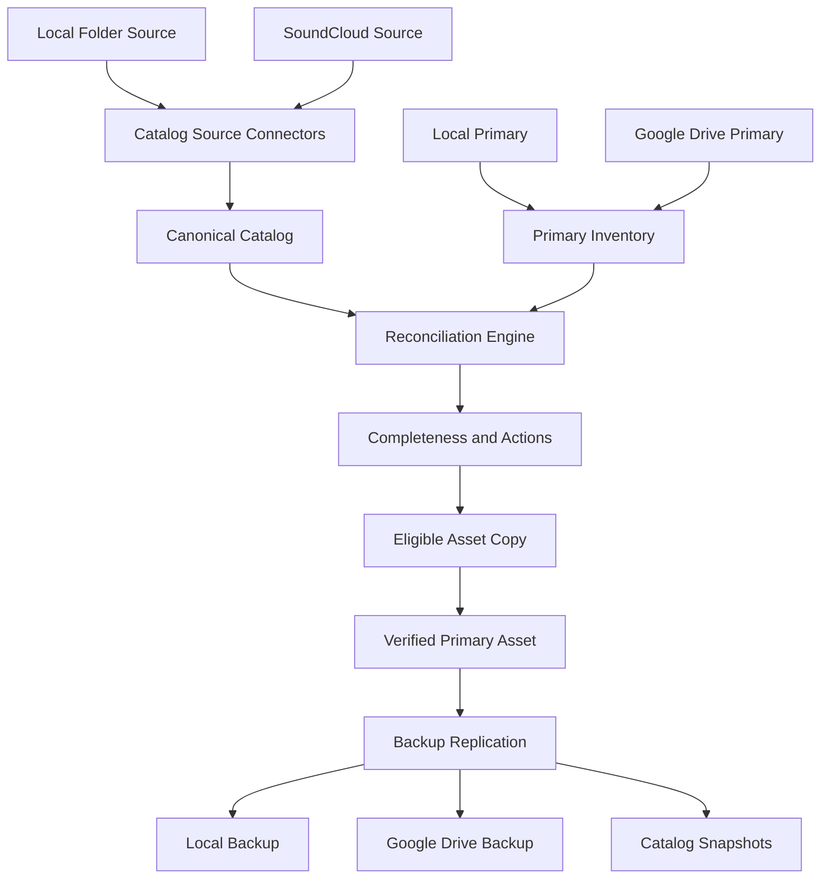
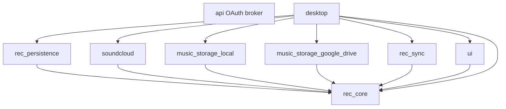

# SoundCloud Sources and Primary Music Storage Plan

**Status:** Stage 1 core contracts implemented and validated; Stage 2 workstreams ready  
**Updated:** 2026-08-13  
**Primary references:**

- [SoundCloud developer documentation](https://developers.soundcloud.com/docs)
- [SoundCloud API guide](https://developers.soundcloud.com/docs/api/guide)
- [Google Drive API download guide](https://developers.google.com/drive/api/guides/manage-downloads)
- [Google Drive File resource](https://developers.google.com/workspace/drive/api/reference/rest/v3/files)

## Implementation progress

- [x] Stage 1: provider-neutral domain, provider, repository, reconciliation, sync, schema, and test-support contracts
- [ ] Stage 2A: SQLite persistence and migrations
- [ ] Stage 2B: SoundCloud connector
- [ ] Stage 2C: SoundCloud OAuth broker
- [ ] Stage 2D: local music storage
- [ ] Stage 2E: Google Drive music storage
- [ ] Stage 2F: reconciliation engine
- [ ] Stage 2G: backup, retention, and job engine
- [ ] Stage 2H: provider-independent UI

## 1. Objective

Extend rec_bag with two distinct provider systems:

1. **Catalog sources** discover tracks, playlists, and source-specific metadata.
   - Existing local folders
   - SoundCloud connected accounts
   - Future catalog providers

2. **Music asset storage** stores and verifies actual audio files.
   - One active primary storage
   - Any number of backup storages
   - Local directories
   - Google Drive
   - Future storage providers

The application must determine whether every unique track discovered from enabled catalog sources has a verified original audio asset in primary storage and whether each verified primary asset has been replicated to configured backups.

## 2. Confirmed product decisions

### 2.1 SoundCloud

- SoundCloud is a catalog source, not automatically an archival file source.
- The first version connects one SoundCloud account per rec_bag profile.
- The data model must support multiple SoundCloud accounts later without migration.
- Synchronize:
  - Tracks uploaded by the connected account
  - Playlists created by the connected account
  - Ordered tracks in those playlists, including tracks from other users
  - Liked tracks
  - Liked playlists and their ordered tracks
- Imported SoundCloud playlists are read-only in rec_bag.
- Local edits require a separate rec_bag playlist or explicit copy.
- The same SoundCloud track appearing in uploads, likes, and multiple playlists maps to one canonical rec_bag track with multiple relationships.
- Remote removal or loss of access updates source status but does not delete canonical tracks, rec_bag playlists, primary files, or backups.
- Direct SoundCloud streaming playback is deferred.
- SoundCloud streaming transcodes must not be archived as primary files.
- Tracks without an explicitly permitted downloadable asset are marked `NotAvailableForArchival`, `PreviewOnly`, or `Blocked`, as appropriate.
- Users can manually locate and associate an owned local file with a SoundCloud track.
- SoundCloud sync runs shortly after startup, every six hours by default, and on demand. The interval is configurable.

### 2.2 Authentication and privacy

- SoundCloud uses OAuth 2.1 authorization code flow with PKCE.
- SoundCloud currently treats clients as confidential and requires a client secret for token exchange and refresh.
- `packages/api` acts as a hosted, stateless OAuth broker.
- The backend stores only application credentials and does not persist user tokens, playlists, likes, or track metadata.
- User tokens are stored by the desktop application in the operating system credential store.
- Refresh-token rotation must be atomic because SoundCloud refresh tokens are single-use.
- Provider credentials and tokens must never be stored in plaintext SQLite configuration fields, logs, or catalog snapshots.

### 2.3 Primary and backup storage

- A rec_bag profile has exactly zero or one active primary music storage.
- A profile can have any number of backup storages.
- Local directories and Google Drive folders can serve as either primary or backup storage.
- Primary storage is authoritative; backups replicate verified primary assets.
- Existing music folders are inventoried in place without automatic movement or copying.
- A local folder can be both a catalog source and primary storage.
- Missing-file handling is configured per source:
  - `CheckOnly`
  - `AskBeforeCopying` — default
  - `AutomaticallyCopyEligibleFiles`
- Backups replicate automatically after a primary asset has been written and verified, unless the backup is configured for scheduled or manual operation.
- Primary deletion does not automatically delete backup copies.
- Deleted or replaced backup versions are retained for 30 days and at least the three most recent versions are kept.
- Permanent cleanup requires explicit confirmation.
- Primary changes use a verified migration workflow. The old primary becomes a backup by default.
- Temporarily unavailable storage retains its known inventory and queues pending work; it must not be treated as empty or deleted.
- Externally changed primary files require verification and approval before changes propagate to backups.
- Unknown audio files found in primary storage enter a review queue rather than being silently imported or ignored.
- rec_bag stores normal, unencrypted audio files initially. Optional client-side encryption is deferred.

### 2.4 Google Drive

- Google Drive uses a user-selected or newly created dedicated rec_bag folder.
- Inventory, uploads, and downloads are limited to that folder and its descendants.
- Use least-privilege authorization, targeting the `drive.file` scope with Google Picker or an equivalent selection flow where practical.
- Broader Drive access is allowed only if required operations cannot be implemented with selected-folder access and the escalation is explained before consent.
- The first version supports My Drive only; Shared Drives are deferred.
- Google Drive files created by rec_bag use private `appProperties` to record stable rec_bag identifiers.
- Google Drive primary playback and audio analysis use a verified local cache.
- The cache is size-limited, reuses verified files, evicts least-recently-used unpinned files, and allows tracks or playlists to be pinned for offline use.
- Cache files do not count as backups.

### 2.5 Identity, matching, and completeness

- Automatically verified matches require strong evidence:
  - Exact content hash
  - Existing persisted source-to-file association
  - Stable rec_bag asset identifier
  - A known copy or upload operation performed by rec_bag
- Artist, title, filename, and duration produce only a possible-match candidate and require user confirmation.
- SHA-256 is rec_bag's canonical checksum. Provider hashes are retained as additional evidence.
- Overall storage totals count unique canonical tracks, not repeated playlist entries.
- Per-playlist completeness is also reported.
- SoundCloud completeness separates:
  - Stored and verified
  - Missing but legitimately obtainable
  - Streaming-only and not available for archival
  - Preview-only
  - Blocked or inaccessible
- Report both:
  - **Archivable completeness:** eligible tracks with verified original assets
  - **Catalog coverage:** tracks for which rec_bag has determined a storage/availability status
- One canonical track can have multiple original assets, such as WAV, FLAC, and purchased MP3 versions.
- Report:
  - **Track completeness:** at least one verified original asset exists
  - **Asset completeness:** every known non-redundant original asset is verified
- Original assets determine archival completeness.
- Converted audio, waveforms, BPM, key, and beat grids are derived data and do not substitute for an original asset.

### 2.6 Metadata

Metadata precedence is field-specific:

1. Explicit user edits
2. Metadata from the verified primary asset
3. SoundCloud metadata
4. Filename-derived fallback values

- SoundCloud synchronization never overwrites explicit user edits.
- Provider metadata is retained separately even when it is not canonical.
- Metadata edits default to catalog-only.
- Explicit `write to file` updates create a new asset version, recompute checksums, verify primary storage, and then replicate to backups.

### 2.7 Recovery and device model

- Catalog snapshots are included in every configured backup.
- Snapshots include tracks, playlists, source relationships, storage mappings, checksums, and non-secret configuration.
- Snapshots are created after successful syncs, reconciliation changes, debounced metadata/playlist changes, before migrations or cleanup, and at least daily while in use.
- Unchanged catalogs do not create duplicate snapshots.
- The first version uses one active managing device per rec_bag profile.
- Catalog snapshots support recovery or transferring the active manager role to another device.
- Concurrent multi-device writers are deferred.

## 3. Current architecture and required correction

The current repository already contains source and storage concepts, but their responsibilities overlap:

- `packages/core/src/source.rs` models local and future cloud locations as `MusicSource`.
- `SourceType` currently includes local filesystem and storage providers such as Google Drive.
- `packages/core/src/storage.rs` defines `StorageBackend`, but that trait stores library metadata rather than music files.
- `SqliteStorage` combines schema management, metadata repositories, settings, sources, and source-track links.
- `packages/core/src/track.rs` requires every `Track` to have one local `PathBuf`.
- Local rescans construct new random track UUIDs and deduplicate in memory by path.
- `packages/desktop/src/state.rs` contains source scanning, persistence orchestration, analysis, playback, diagnostics, and UI state in one large module.
- `packages/ui/src/sources_panel.rs` assumes every source can be represented as a local path and folder tree.
- `packages/api` currently exposes only an echo server function.

The implementation must split these responsibilities before provider work begins.

## 4. Target terminology

| Term | Meaning |
| --- | --- |
| Catalog source | Provider from which tracks and playlists are discovered |
| Source occurrence | One provider-specific representation of a canonical track |
| Canonical track | Central logical track record used by playlists and matching |
| Original asset | An owned audio file representing a track |
| Derived asset | A conversion or cache that can be recreated |
| Primary storage | Authoritative location for original music assets |
| Backup storage | Retained replica of verified primary assets and catalog snapshots |
| Catalog database | Local SQLite metadata and relationship database |
| Provider object | A local file, Drive file, or future storage-specific object |
| Reconciliation | Comparison of catalog requirements with storage inventory |

The existing metadata `StorageBackend` should be renamed to avoid collision with music asset storage, for example `LibraryRepository` or `CatalogRepository`.

## 5. Target architecture



## 6. Workspace boundaries for parallel implementation

Use separate crates to isolate dependencies and create disjoint write ownership after core contracts are frozen.

```text
packages/
├── core/                         # Existing: domain models, traits, pure logic
├── persistence/                  # New: SQLite repositories and migrations
├── soundcloud/                   # New: SoundCloud API client and sync adapter
├── music_storage_local/          # New: local inventory and file operations
├── music_storage_google_drive/   # New: Drive API and local cache adapter
├── sync/                         # New: reconciliation, jobs, replication, retention
├── api/                          # Existing: stateless SoundCloud OAuth broker
├── ui/                           # Existing: provider-independent UI components
└── desktop/                      # Existing: runtime composition and platform services
```

Final crate names can be adjusted before scaffolding, but provider and persistence implementations should not be placed back into `rec_core`.

### 6.1 Dependency direction



Provider crates must not depend on `desktop` or Dioxus. `rec_sync` operates against core traits and must be testable with in-memory fakes.

## 7. Stage 1: serial core-contract foundation

This stage is intentionally completed before parallel provider work. Its output is a stable public contract and shared test fixtures.

### 7.1 Domain models

Add or revise models for:

- `CatalogSource`
- `CatalogSourceKind`
- `SourceAccount`
- `SourceTrackOccurrence`
- `ExternalPlaylist`
- `ExternalPlaylistEntry`
- `CanonicalTrack`
- `TrackMetadata` with field provenance
- `OriginalAsset`
- `DerivedAsset`
- `MusicStorage`
- `MusicStorageKind`
- `StorageRole`
- `StorageObject`
- `StorageCapabilities`
- `SourceAvailability`
- `StorageVerificationStatus`
- `MatchEvidence`
- `MatchConfidence`
- `ReconciliationResult`
- `SyncRun`, `SyncCursor`, `SyncProgress`, and `SyncError`
- Backup retention and replication policy

Suggested provider-independent enums:

```rust
pub enum CatalogSourceKind {
    LocalFolder,
    SoundCloud,
}

pub enum MusicStorageKind {
    LocalDirectory,
    GoogleDrive,
}

pub enum StorageRole {
    Primary,
    Backup,
}

pub enum SourceAvailability {
    Obtainable,
    MetadataOnly,
    StreamingOnly,
    PreviewOnly,
    Blocked,
    Removed,
    Inaccessible,
}

pub enum StorageVerificationStatus {
    Verified,
    Missing,
    PossibleMatch,
    AmbiguousMatch,
    ChangedPendingReview,
    Unavailable,
    Error,
}
```

Exact names may change, but providers must map into shared semantic states.

### 7.2 Canonical identity

- Preserve canonical UUIDs across rescans.
- Source occurrences use a unique key of `(source_id, external_id)`.
- Local sources use a stable occurrence identity based on persisted file identity and relative path, with content hash used to survive moves when available.
- SoundCloud uses the provider track ID as `external_id`.
- Playlist entries reference canonical track IDs and store position separately.
- Track records no longer require one mandatory local path.
- Asset locations live in asset/provider-object records.

### 7.3 Traits

Define object-safe async provider contracts or otherwise choose a consistent dynamic-dispatch strategy.

#### Catalog source connector

```rust
pub trait CatalogSourceConnector {
    async fn health(&self) -> Result<SourceHealth, SourceError>;
    async fn sync_page(&self, request: SourceSyncRequest)
        -> Result<SourceSyncPage, SourceError>;
}
```

The request/result types must support tracks, owned playlists, uploaded tracks, likes, pagination cursors, removals, and provider metadata without forcing all providers to expose identical endpoints.

#### Music asset store

```rust
pub trait MusicAssetStore {
    async fn health(&self) -> Result<StorageHealth, MusicStorageError>;
    async fn inventory_page(&self, request: InventoryRequest)
        -> Result<InventoryPage, MusicStorageError>;
    async fn stat(&self, object_id: &str)
        -> Result<StorageObject, MusicStorageError>;
    async fn upload(&self, request: UploadRequest)
        -> Result<StorageObject, MusicStorageError>;
    async fn download(&self, request: DownloadRequest)
        -> Result<DownloadResult, MusicStorageError>;
}
```

Destructive deletion is excluded from the initial provider contract. Retention cleanup uses a later, explicit capability and confirmation flow.

#### Repository contracts

Define narrow repositories instead of one large storage type:

- `TrackRepository`
- `PlaylistRepository`
- `SourceRepository`
- `AssetRepository`
- `MusicStorageRepository`
- `SyncRunRepository`
- `SettingsRepository`
- `CatalogSnapshotRepository`

### 7.4 Shared contract tests

Core provides reusable provider contract tests and fakes for:

- Pagination and cursor continuation
- Idempotent source upserts
- Stable external identity
- Inventory and stat consistency
- Upload result verification
- Temporary unavailability semantics
- Capability handling
- Cancellation and progress events
- Error classification

### 7.5 Stage 1 exit criteria

- Core compiles without depending on provider HTTP libraries or Dioxus.
- All shared models serialize and deserialize.
- Trait fakes pass the shared contract tests.
- Schema requirements are documented and versioned.
- Public contracts are frozen for the first provider implementation cycle.
- Existing track, playlist, analysis, and playback behavior has a documented migration path.

## 8. Stage 2: maximally parallel workstreams

After Stage 1, the following workstreams can proceed concurrently. Each stream has a disjoint primary write set.

### Workstream A: SQLite persistence and migrations

**Primary ownership:** `packages/persistence/**`  
**Dependencies:** frozen core contracts

Deliverables:

- Versioned migration runner and schema version table
- Repositories implementing the core contracts
- Transactional source sync application
- Transactional refresh-token metadata updates without storing secrets
- Snapshot export/import format
- Migration from the existing tables
- Compatibility loading for existing libraries
- Database indexes and uniqueness constraints

Proposed logical tables:

- `tracks`
- `track_metadata_values` or equivalent provenance representation
- `playlists`
- `playlist_tracks`
- `catalog_sources`
- `source_accounts`
- `source_tracks`
- `external_playlists`
- `external_playlist_tracks`
- `music_storages`
- `original_assets`
- `derived_assets`
- `storage_objects`
- `asset_locations`
- `match_candidates`
- `sync_runs`
- `sync_errors`
- `settings`
- `catalog_snapshots`

Migration requirements:

1. Preserve all existing track and playlist UUIDs.
2. Convert existing `sources` to local-folder catalog sources.
3. Convert `source_tracks` links to stable source occurrences.
4. Convert track paths into local asset-location records.
5. Do not designate a primary automatically.
6. Do not move, rename, or copy existing audio files.
7. Back up the old database before applying the first structural migration.

Tests:

- Empty database migration
- Current-schema migration
- Interrupted migration recovery
- Referential integrity
- Duplicate source occurrence prevention
- Snapshot round trip
- Existing playlist and analysis preservation

### Workstream B: SoundCloud connector

**Primary ownership:** `packages/soundcloud/**`  
**Dependencies:** frozen source contracts; token-provider interface

Deliverables:

- Typed SoundCloud HTTP client
- Authorization header and token refresh callback integration
- Account identity retrieval
- Uploaded-track synchronization
- Owned-playlist synchronization
- Playlist entry synchronization with ordering
- Liked-track synchronization
- Liked-playlist synchronization and ordered entries
- Pagination through `next_href`
- Access mapping for playable, preview, blocked, removed, and inaccessible tracks
- Provider metadata preservation
- Rate-limit handling and exponential backoff
- Sync cursor/checkpoint support
- Idempotent provider-to-core mapping

The implementation must validate exact current endpoints and response schemas against SoundCloud's OpenAPI/API Explorer before coding each endpoint. API responses must be fixture-tested to prevent accidental assumptions based only on prose documentation.

Out of scope:

- Direct streaming playback
- Saving streaming transcodes
- Modifying SoundCloud playlists
- Uploading or deleting SoundCloud tracks
- Likes/reposts/comments writes
- Arbitrary public URL imports in the first release

Tests:

- Multi-page collections
- Duplicate tracks across uploads, likes, and playlists
- Playlist ordering
- Private content
- Preview and blocked access
- Removed resources
- 401 refresh and retry
- Single-use refresh rotation callback
- 429 backoff
- 5xx retry limits
- Partial sync resume

### Workstream C: SoundCloud OAuth broker

**Primary ownership:** `packages/api/**`  
**Dependencies:** OAuth request/response DTO contract only

Deliverables:

- OAuth authorization-code exchange endpoint
- Refresh-token exchange endpoint
- PKCE verifier forwarding
- OAuth state/nonce validation responsibilities clearly split with desktop
- Strict redirect URI allow-list
- Secret loading from deployment environment
- Response redaction and safe error mapping
- Rate limiting and abuse protection
- No persistent user token storage
- Deployment and rotation documentation

Tests:

- Valid exchange
- Invalid state/input rejection
- Redirect URI rejection
- Refresh rotation response
- SoundCloud error pass-through without secret leakage
- Logs do not contain codes, tokens, or secrets

### Workstream D: local music storage

**Primary ownership:** `packages/music_storage_local/**`  
**Dependencies:** frozen music-storage contracts

Deliverables:

- Recursive inventory with supported and recognized audio classification
- SHA-256 computation
- Incremental stat data
- Atomic copy through temporary files and rename
- Collision-safe managed naming
- Direct local playback path resolution
- Local external-change watching adapter
- Managed backup history directory
- Retention candidate listing
- Same-folder and nested-folder safety checks
- Unavailable removable-drive handling

Managed naming convention:

```text
Artist/Title [short-track-id].ext
Unknown Artist/Original Filename [short-track-id].ext
```

Tests:

- Empty and large directory inventories
- Duplicate filenames
- Same content at multiple paths
- Same source and primary directory
- Nested source/primary loops
- Interrupted copy cleanup
- Atomic replacement
- Read-only and unavailable drives
- External rename detection
- Retention history behavior

### Workstream E: Google Drive music storage

**Primary ownership:** `packages/music_storage_google_drive/**`  
**Dependencies:** frozen music-storage contracts; Google token-provider interface

Deliverables:

- OAuth token consumption and refresh integration
- Dedicated-folder selection representation
- Descendant-only paginated inventory
- Drive file ID, version, size, MIME type, modified time, and hash mapping
- `capabilities.canDownload` handling
- Resumable upload
- Verified download to temporary local files
- Private `appProperties` with rec_bag track and asset IDs
- Trashed-file handling
- Duplicate-name handling by file ID
- Drive change cursor support
- Retry and backoff
- Local playback/analysis cache
- LRU eviction and offline pinning
- My Drive support only

Tests use a mock HTTP server or transport abstraction and cover:

- Paginated inventory
- Restricted folder boundary
- Duplicate names
- Resumable upload recovery
- Hash verification
- Download restrictions
- Token expiry
- Rate limits and temporary failures
- Trashed and externally modified files
- Cache hit, eviction, pinning, and corruption recovery

### Workstream F: reconciliation engine

**Primary ownership:** `packages/sync/src/reconciliation/**`  
**Dependencies:** frozen core contracts and provider fakes

Deliverables:

- Unique-track requirements derived from enabled sources
- Per-playlist requirements
- Original-asset and asset-location evaluation
- Strong-match rules
- Metadata candidate scoring without automatic confirmation
- SoundCloud archival-availability classification
- Untracked-primary review candidates
- Changed-primary review candidates
- Track and asset completeness reports
- Action plans for copy, associate, ignore, retry, and manual locate
- Deterministic, pure reconciliation where practical

Automatic match evidence order:

1. Existing asset-location association with unchanged provider version/hash
2. Exact SHA-256
3. rec_bag asset identifier in provider metadata
4. Recorded rec_bag copy/upload result
5. Other stable standard identifiers when verified
6. Metadata-only candidate requiring confirmation

Tests:

- Exact hash match
- Persisted association
- Drive `appProperties` match
- Metadata-only candidate
- Remix/alternate-version ambiguity
- Multiple originals per canonical track
- One track in many playlists
- SoundCloud streaming-only track
- Removed and inaccessible source occurrence
- Unknown file in primary
- Unavailable storage versus empty storage

### Workstream G: backup, retention, and job engine

**Primary ownership:** `packages/sync/src/jobs/**`, `packages/sync/src/replication/**`, and `packages/sync/src/retention/**`  
**Dependencies:** frozen storage contracts and fakes

Deliverables:

- Persistent job plans and state transitions
- Primary-to-backup replication planner
- Immediate post-copy verification
- Automatic, scheduled, and manual backup modes
- Pending queue for unavailable targets
- Non-propagating primary deletion behavior
- External-change approval gate
- Version retention policy
- Catalog snapshot triggers
- Cancellation, restart, and retry semantics
- Progress and structured error events

Default retention:

- Current verified version
- Replaced/deleted versions for 30 days
- At least three most recent versions
- Explicit confirmation for permanent cleanup

Verification schedule:

- Immediate verification after replication
- Changed-object verification on provider version changes
- Rotating daily sample
- Full monthly backup inventory
- Manual verification action

Tests:

- Idempotent replication
- Partial upload/copy restart
- Unavailable backup queue
- Primary deletion retention
- External corruption not propagated
- Version expiration rules
- Snapshot trigger debounce
- Multi-backup independent failure

### Workstream H: provider-independent UI

**Primary ownership:** new files under `packages/ui/**`  
**Dependencies:** frozen view models/events; mock data only

Deliverables:

- Source provider chooser
- SoundCloud account/source card
- Source sync status and progress
- Uploaded, liked, and playlist sections
- Primary storage configuration panel
- Backup target list and policy editor
- Storage health indicators
- Completeness dashboard
- Per-playlist completeness
- Track storage badges and filters
- Possible-match review dialog
- Manual local-file association dialog
- Unknown-primary-file review queue
- Primary migration wizard UI
- Backup retention/cleanup review
- Offline pinning controls

Existing `SourcesPanel` must stop constructing local folder trees for every source. Local browsing becomes a source-kind-specific component.

UI work must use mock state and event handlers during this stage; it must not depend on desktop provider implementations.

## 9. Stage 3: parallel integration slices

After individual workstreams pass contract tests, integrate in separate vertical slices where possible.

### Slice 1: local source to local primary

- Existing local source migration
- Local source stable identity
- Inventory in place
- Reconciliation
- Manual/automatic eligible copy
- Direct playback
- Primary completeness UI

### Slice 2: SoundCloud catalog

- Desktop OAuth browser flow and callback
- OS credential-store integration
- API broker exchange
- Source creation and health
- Uploaded tracks, owned playlists, likes, and liked playlists
- Persistence and read-only UI
- Archival availability statuses

### Slice 3: Google Drive primary

- Google OAuth and folder selection
- Storage configuration
- Inventory and reconciliation
- Resumable upload
- Download cache
- Playback and analysis resolver
- Primary migration workflow

### Slice 4: backup replication

- Local-to-Drive
- Drive-to-local
- Local-to-local
- Drive-to-Drive if supported by the generic download/upload path
- Catalog snapshots
- Retention review

### Slice 5: reconciliation review actions

- Confirm/reject metadata candidates
- Locate local file for SoundCloud track
- Import/associate/ignore unknown primary files
- Approve external primary changes
- Retry failures

Integration slices should avoid modifying the same desktop module by first splitting `packages/desktop/src/state.rs` into focused services and state modules.

Suggested desktop structure:

```text
packages/desktop/src/
├── state/
│   ├── mod.rs
│   ├── catalog.rs
│   ├── playback.rs
│   ├── sources.rs
│   ├── storages.rs
│   ├── sync_jobs.rs
│   └── diagnostics.rs
├── services/
│   ├── credentials.rs
│   ├── oauth_callbacks.rs
│   ├── provider_registry.rs
│   └── asset_resolver.rs
└── views/
```

## 10. Stage 4: system assembly and hardening

This is the convergence stage and should have a single integration owner.

Deliverables:

- Application startup and migration order
- Provider registry and dependency injection
- Background scheduler
- Save/snapshot coordination
- Graceful shutdown and job checkpointing
- One-active-manager profile marker
- Recovery and catalog restore workflow
- End-to-end error presentation
- Documentation and setup guides
- SoundCloud and Google API compliance review
- Performance testing with large libraries

## 11. Core workflows

### 11.1 SoundCloud synchronization

1. Desktop opens the SoundCloud authorization page with PKCE and state.
2. The callback returns an authorization code to desktop.
3. Desktop sends the code and verifier to the stateless rec_bag API broker.
4. The broker exchanges it using the confidential SoundCloud client credentials.
5. Desktop stores access and refresh tokens in the OS credential store.
6. The SoundCloud connector retrieves account identity and collection pages.
7. Provider objects map to stable source occurrences.
8. Persistence applies each page transactionally and checkpoints the cursor.
9. Canonical tracks are created or linked.
10. Reconciliation recalculates availability and primary status.
11. Catalog snapshots are scheduled after successful completion.

A failed page must not erase previously synchronized data. Removals are finalized only after a complete authoritative collection pass or explicit provider deletion evidence.

### 11.2 Local file to primary storage

1. Reconciliation identifies an eligible missing original asset.
2. The source policy determines check-only, confirmation, or automatic copy.
3. rec_bag computes or confirms the source SHA-256.
4. The destination path is generated from canonical metadata and stable ID.
5. The file copies to a temporary destination.
6. The destination checksum is verified.
7. The temporary object atomically becomes the primary object.
8. Asset and location mappings commit transactionally.
9. Backup jobs are queued.
10. A catalog snapshot is scheduled.

### 11.3 SoundCloud manual file association

1. User chooses `Locate matching file`.
2. rec_bag reads tags, duration, codec information, size, and SHA-256.
3. The UI compares local and SoundCloud metadata.
4. Strong existing evidence can confirm automatically; otherwise the user confirms.
5. The file becomes an original asset of the canonical track.
6. The source copy policy determines whether it is copied into primary storage.

### 11.4 Google Drive playback

1. Asset resolver checks the managed local cache.
2. A verified cache hit returns a local path.
3. Otherwise, rec_bag verifies Drive download capability.
4. The file downloads to a temporary cache path.
5. SHA-256/provider hash is verified.
6. The cache entry commits and returns a local path.
7. The audio engine loads the local path.

### 11.5 Primary migration

1. Configure and health-check the candidate primary.
2. Inventory candidate and current primary.
3. Reconcile existing verified matches.
4. Copy missing assets to candidate.
5. Verify all required assets.
6. Create a catalog snapshot.
7. Ask for final confirmation.
8. Atomically switch storage roles.
9. Keep the old primary as a backup by default.

### 11.6 External primary modification

1. Incremental inventory detects a provider version, size, or hash change.
2. Mark the asset `ChangedPendingReview`.
3. Validate that it is readable audio.
4. Compare duration, metadata, and content characteristics.
5. Do not propagate it to backups.
6. User approves the new version, restores the previous version, or associates it elsewhere.
7. Approved versions replicate while older backup versions remain under retention policy.

## 12. Inventory and verification schedules

### Primary storage

- Verify newly copied or changed files immediately.
- Use filesystem events for local primary storage.
- Use Google Drive change tracking for Drive primary storage.
- Run full inventory weekly.
- Rehash only when provider version, size, modification data, or stored evidence indicates change.
- Support manual `Verify now`.

### Backup storage

- Verify immediately after replication.
- Verify provider-reported changes.
- Verify a rotating sample daily.
- Run complete backup inventory monthly.
- Support manual `Verify backup`.

### SoundCloud

- Sync shortly after startup.
- Sync every six hours while running by default.
- Allow interval changes or disabling automatic sync.
- Support manual `Sync now`.
- Retry temporary failures with exponential backoff and jitter.

## 13. UI information architecture

### Sources area

- Add-source provider chooser
- Local folder sources with folder browser
- SoundCloud source with account identity and authentication health
- Separate groups for uploads, created playlists, liked tracks, and liked playlists
- Last sync, next sync, progress, warning, and error states
- Read-only indicator for SoundCloud playlists
- Non-destructive disconnect action

### Storage area

- Primary storage card
- Backup storage cards
- Local/Google Drive provider setup
- Health and availability
- Inventory and verification timestamps
- Replication mode
- Retention summary
- Pending jobs and failures
- Primary migration action

### Completeness dashboard

- Unique canonical track totals
- Archivable completeness
- Catalog coverage
- Asset completeness
- Per-playlist completeness
- Missing but obtainable
- Streaming-only/not archival
- Preview-only/blocked/inaccessible
- Possible and ambiguous matches
- Unknown primary files
- Backup gaps
- Provider errors

### Track actions

- Copy to primary
- Locate matching file
- Confirm/reject candidate
- Choose preferred original asset
- Pin/unpin for offline playback
- Retry verification
- Show source occurrences
- Show primary and backup locations

## 14. Security and compliance requirements

- Never embed the SoundCloud client secret in desktop, web, or mobile binaries.
- Use PKCE and state/nonce validation.
- Allow-list OAuth redirect URIs.
- Store user tokens in the OS credential store.
- Redact authorization codes, access tokens, refresh tokens, and provider secrets from logs and errors.
- Make refresh-token replacement atomic.
- Use least-privilege Google scopes.
- Do not archive SoundCloud playback transcodes.
- Preserve SoundCloud attribution requirements if direct streaming is implemented later.
- Validate API terms and app-registration prerequisites before release; current SoundCloud documentation states an Artist Pro account is required to register an app.
- Catalog snapshots must exclude secrets and local credential-store material.
- File cleanup is always explicit and auditable.

## 15. Observability and job behavior

Replace provider-operation `eprintln!` calls with structured job state.

Each sync, inventory, copy, verification, migration, and backup run records:

- Job ID and type
- Provider/source/storage ID
- Start and finish timestamps
- Cursor/checkpoint
- Total, processed, succeeded, skipped, and failed counts
- Retry count
- Current item description without secrets
- Classified error code
- User-actionable message
- Cancellation and resume state

Provider errors should distinguish:

- Authentication required
- Permission denied
- Rate limited
- Temporarily unavailable
- Not found/removed
- Download prohibited
- Invalid data
- Checksum mismatch
- Local I/O failure
- Permanent provider rejection

## 16. Validation strategy

### Per-workstream validation

Each new crate must run:

```sh
cargo fmt --check
cargo check -p <crate>
cargo test -p <crate>
```

Provider crates must pass shared core contract tests before desktop integration.

### Workspace validation

```sh
cargo fmt --check
cargo check --workspace
cargo test --workspace
```

Also validate relevant feature combinations independently, including desktop and server builds.

### End-to-end scenarios

1. Migrate an existing local library without moving files.
2. Select the existing source directory as primary and verify in place.
3. Select a different local primary and copy eligible files.
4. Connect SoundCloud and import uploads, owned playlists, liked tracks, and liked playlists.
5. Confirm one SoundCloud track is streaming-only and excluded from archivable denominator.
6. Manually associate a local file with a SoundCloud track.
7. Configure Google Drive as primary and play through local cache.
8. Configure local and Drive backups and verify automatic replication.
9. Disconnect a backup, queue work, reconnect, and resume.
10. Modify a primary file externally and ensure backups do not update before approval.
11. Delete a primary file and ensure backup copies are retained.
12. Change primary storage through the verified migration workflow.
13. Restore a catalog snapshot on another device and assume manager ownership.

## 17. Parallel execution matrix

| Stage | Workstream | Can run with | Primary write set |
| --- | --- | --- | --- |
| 1 | Core contracts | Nothing dependent until complete | `packages/core/**` |
| 2A | Persistence | 2B–2H | `packages/persistence/**` |
| 2B | SoundCloud connector | 2A, 2C–2H | `packages/soundcloud/**` |
| 2C | OAuth broker | 2A, 2B, 2D–2H | `packages/api/**` |
| 2D | Local storage | 2A–2C, 2E–2H | `packages/music_storage_local/**` |
| 2E | Google Drive | 2A–2D, 2F–2H | `packages/music_storage_google_drive/**` |
| 2F | Reconciliation | 2A–2E, 2G–2H | `packages/sync/src/reconciliation/**` |
| 2G | Backup/jobs | 2A–2F, 2H | `packages/sync/src/jobs/**`, `replication/**`, `retention/**` |
| 2H | UI with mocks | 2A–2G | new `packages/ui/**` files |
| 3 | Integration slices | Other slices if desktop files are partitioned first | assigned `desktop` modules |
| 4 | Final assembly | Serial integration owner | app composition and shared config |

To preserve parallelism:

- Scaffold all crates and placeholder modules immediately after Stage 1.
- Assign one owner to the root workspace `Cargo.toml` and lockfile changes.
- Assign disjoint desktop modules before integration slices begin.
- Avoid provider-specific enums in desktop/UI; use core capabilities and status models.
- Route contract changes through the Stage 1 owner rather than allowing providers to diverge.

## 18. Risks and mitigations

### SoundCloud app access

**Risk:** SoundCloud app registration and API access may require an Artist Pro account and approval.  
**Mitigation:** Verify credentials and required endpoints with a minimal authenticated spike before full connector implementation.

### SoundCloud archival expectations

**Risk:** Users may expect every liked track to be copied from SoundCloud.  
**Mitigation:** Clearly distinguish catalog coverage, archivable completeness, and streaming-only availability. Never treat streams as original files.

### Google Drive limited scope

**Risk:** `drive.file` plus folder selection may not support every desired existing-folder operation.  
**Mitigation:** Build an authorization spike and capability test. Escalate scope only with explicit user consent and documentation.

### Large libraries

**Risk:** Full hashing and cloud inventories can be expensive.  
**Mitigation:** Incremental version evidence, persisted cursors, bounded concurrency, resumable jobs, and scheduled full checks.

### False matches

**Risk:** Metadata-only matching can associate the wrong remix or version.  
**Mitigation:** Require strong evidence for automatic verification and manual confirmation for metadata candidates.

### Backup corruption propagation

**Risk:** External replacement or corruption of primary files may replicate automatically.  
**Mitigation:** External changes enter review and do not propagate before approval.

### Existing model migration

**Risk:** Tracks embedded in playlists can diverge, and current paths are mandatory.  
**Mitigation:** Preserve IDs, normalize playlist membership, migrate paths into asset locations, snapshot before migration, and test against current-schema fixtures.

### Parallel contract drift

**Risk:** Independent provider teams may require incompatible model changes.  
**Mitigation:** Freeze Stage 1 contracts, provide capability-based extension points, and centralize contract-change review.

## 19. Completion criteria

The feature is complete when:

- Existing local libraries migrate without file movement or data loss.
- Local and SoundCloud catalog sources use stable identities across repeated synchronization.
- SoundCloud uploads, owned playlists, liked tracks, and liked playlists synchronize idempotently with ordering preserved.
- SoundCloud streaming-only, preview, blocked, removed, and inaccessible tracks have accurate non-archival statuses.
- Users can associate an owned local file with a SoundCloud canonical track.
- One local or Google Drive storage can be selected as primary.
- Multiple local or Google Drive backups can be configured.
- Every unique source track has an actionable reconciliation status.
- Exact matches are automatically verified and metadata-only matches require confirmation.
- Google Drive assets upload, download, inventory, cache, and verify correctly.
- Backup replication is automatic after verified primary changes and resilient to unavailable targets.
- Primary deletions do not automatically delete backups.
- External primary changes do not propagate without approval.
- Version retention and catalog snapshots support recovery.
- Per-track, per-asset, per-playlist, primary, and backup completeness are visible in the UI.
- Provider and reconciliation contract tests pass.
- Workspace formatting, checks, and tests pass.

## 20. Explicitly deferred work

- Direct SoundCloud streaming playback
- Arbitrary public SoundCloud URL sources
- Two-way SoundCloud playlist editing
- Multiple active SoundCloud accounts in one profile
- Shared Drives
- Concurrent multi-device writers
- Client-side music-file encryption
- Automatic destructive mirroring or backup deletion
- Additional providers such as Dropbox, S3, WebDAV, or other streaming catalogs
